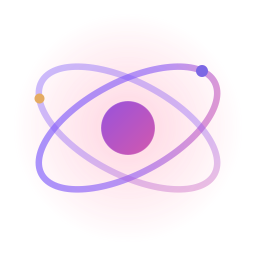
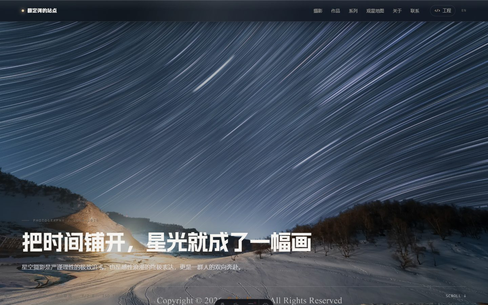
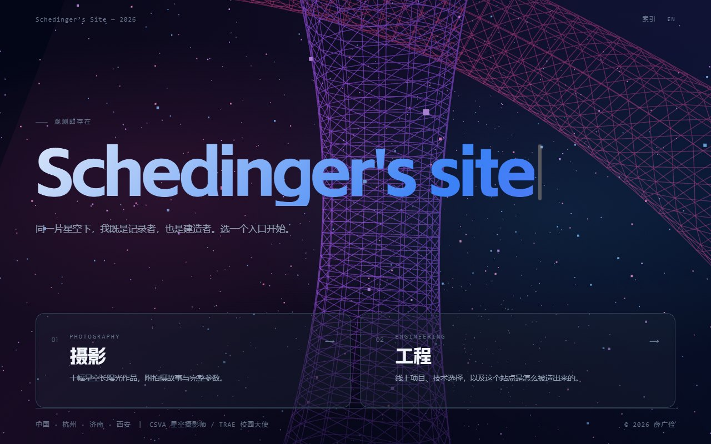
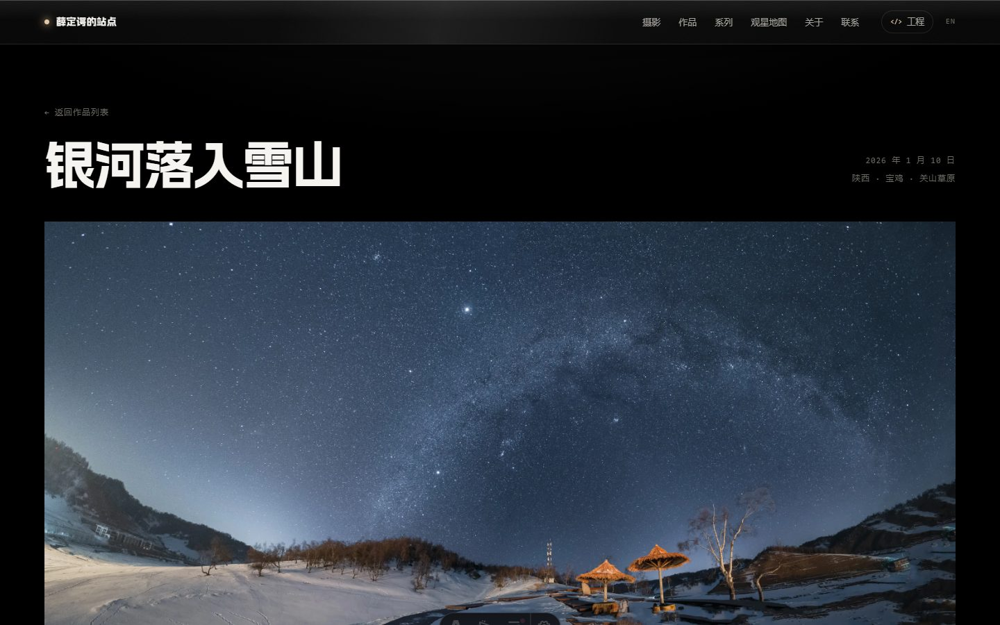
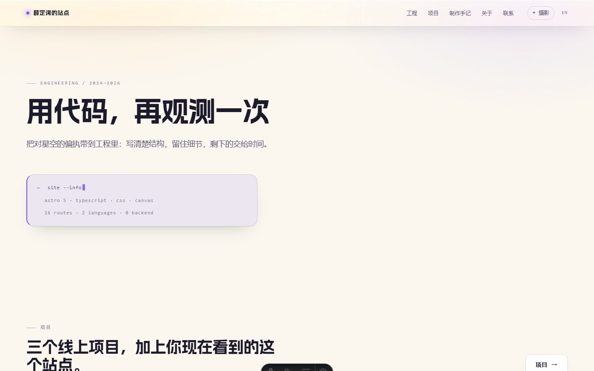

<p align="center">
  
</p>

<h1 align="center">Schrödinger's Site<br><sub>ASTROPHOTOGRAPHY &amp; ENGINEERING PORTFOLIO</sub></h1>

<p align="center">
  A dual portfolio of an astrophotographer and physics student: one photography track, one engineering track — independent in rhythm and colour, sharing the same type, grid and motion language.
</p>

<p align="center">
  <a href="https://astro.build"></a>
  <a href="https://www.typescriptlang.org"></a>
  <a href="https://github.com/xue-ding-e-a/schedingers-site/actions/workflows/deploy.yml"></a>
  <a href="README.md"></a>
  <a href="#license--credits"></a>
</p>

<p align="center">
  <a href="https://xue-ding-e-a.github.io/schedingers-site/en/">Live Site</a> ·
  <a href="https://xue-ding-e-a.github.io/schedingers-site/en/photo/">Photography</a> ·
  <a href="https://xue-ding-e-a.github.io/schedingers-site/en/dev/">Engineering</a> ·
  <a href="https://xue-ding-e-a.github.io/schedingers-site/en/build/">Build Log</a> ·
  <a href="README.md">中文</a>
</p>

<p align="center">
  
</p>

## Why This Site

Portfolio templates look good, but most of them show the result, not the process. This project tries to answer two questions at once:

- How can a photography portfolio let the photographs set the layout, instead of forcing them into identical cards?
- How can an engineering portfolio still show technical judgement when three of its four projects have no public repository?

So the site splits into two entries: photography in black, engineering in white, sharing only the type, grid, footer and neutral index pages.

## Screens



| Work detail | Engineering home |
| --- | --- |
|  |  |
| Capture coordinates, gear, EXIF and a bilingual story | Project matrix and terminal-style facts card |

## Features

- Dual-track portal: [photography](https://xue-ding-e-a.github.io/schedingers-site/en/photo/) and [engineering](https://xue-ding-e-a.github.io/schedingers-site/en/dev/) each have their own navigation, home rhythm and theme.
- [10 astrophotographs](https://xue-ding-e-a.github.io/schedingers-site/en/works/), [4 series](https://xue-ding-e-a.github.io/schedingers-site/en/collections/) and [4 engineering projects](https://xue-ding-e-a.github.io/schedingers-site/en/projects/), mirrored in Chinese and English.
- Curated works are sorted by original file size: larger files get larger cards, with horizontal scrolling only. See [photo.astro](src/pages/photo.astro).
- The [work detail page](https://xue-ding-e-a.github.io/schedingers-site/en/works/galactic-arch-snow-mountain/) shows capture coordinates, camera, lens, EXIF and stacking method.
- The navigation keeps its frosted glass, grain and lifted shadow even on solid backgrounds. See [BaseLayout.astro](src/layouts/BaseLayout.astro).
- Zero framework JS by default; the Three.js particle background loads on demand on the [home page](src/pages/index.astro) only.
- Images are preprocessed offline into WebP and thumbnails, with average-colour placeholders to prevent flash-of-white. See [public/images/works](public/images/works).

## Stack

| Layer | Choice | Why |
| --- | --- | --- |
| Framework | Astro 5 | Content-heavy, interaction-light, zero JS by default |
| Types | TypeScript | Locks down bilingual EXIF, coordinate and copy fields |
| Styling | Vanilla CSS | Aspect ratios run from 0.67 to 2.14; hand-written grids beat breakpoint tuning |
| Images | Python / Pillow | Largest original is 144 MB and 168 megapixels, processed before build |
| Background | Canvas 2D + Three.js | 2D star field on the portal, particle background loaded on demand |
| Deployment | GitHub Pages + Actions | Push to main builds and publishes |

## Quick Start

Requires Node.js 20 or newer.

```bash
npm install
npm run dev       # local development
npm run build     # static output in dist/
npm run preview   # preview the build
```

## Project Structure

```text
src/
├─ components/        WorkCard, ProjectCard
├─ data/              works.ts / series.ts / projects.ts (content and bilingual fields)
├─ i18n/              ui.ts (copy dictionary), utils.ts (language and path helpers)
├─ layouts/           BaseLayout.astro (navigation, footer, theme switch)
├─ pages/             Chinese pages; en/ holds the English mirror
├─ styles/            global.css (design tokens and global styles)
└─ consts.ts          Site info and the three navigations (NAV / PHOTO_NAV / DEV_NAV)
public/
└─ images/            Work images, thumbnails and map assets
```

## Content Maintenance

- Add a work: edit [src/data/works.ts](src/data/works.ts), fill in both languages and the `thumb` path, and put images in `public/images/works/`.
- Add a series: edit [src/data/series.ts](src/data/series.ts); the detail route is generated by `src/pages/collections/[slug].astro`.
- Add a project: edit [src/data/projects.ts](src/data/projects.ts).
- Change navigation: edit [src/consts.ts](src/consts.ts); photography and engineering use `PHOTO_NAV` and `DEV_NAV`.
- Change copy: edit [src/i18n/ui.ts](src/i18n/ui.ts); every key must provide both `zh` and `en`. Keep `README.md` in sync with this file.

## Deployment

Pushing to `main` makes GitHub Actions build and publish to GitHub Pages. The workflow lives in [deploy.yml](.github/workflows/deploy.yml).

The site URL and subpath are configured in [astro.config.mjs](astro.config.mjs):

```js
site: 'https://xue-ding-e-a.github.io',
base: '/schedingers-site',
```

If the repository is renamed, update `base` as well or static assets will 404.

## Changelog

Each iteration is recorded by feature batch in the site's [Build Log](https://xue-ding-e-a.github.io/schedingers-site/en/build/), including technical choices, the split between AI and human work, the timeline and retrospective notes. Recent batches:

- `2026.11.17` Deployment first: subpath, Actions and asset paths aligned
- `2026.11.17` Replacing the generic dark template: Darkness visual system and particle hero
- `2026.11.17` Chinese type no longer mixed: four font stacks and the full font set
- `2026.11.17` Split into two tracks: photography black / engineering white
- `2026.11.18` Curated works: horizontal scroll only
- `2026.11.18` Contact entry added to the photography navigation

## Contributing

Issues are welcome for typos, factual errors or accessibility problems. Before opening a PR:

1. Keep Chinese and English fields paired;
2. Run `npm run build` and confirm there are no errors;
3. Do not commit uncompressed originals; convert images to WebP and thumbnails first.

## License & Credits

- All astrophotographs on this site are copyright the author. Commercial use, exhibition, printing or redistribution requires permission; see the [credits page](https://xue-ding-e-a.github.io/schedingers-site/en/credits/).
- The code carries no open-source licence. Please contact the author before reuse.
- Map data from OpenStreetMap and CARTO; typefaces: UP Job Heading, UP Job Numeric, Space Grotesk, DM Sans and system fonts.

## Contact

- Email: 2543165843@qq.com
- WeChat: schedinger
- GitHub: [@xue-ding-e-a](https://github.com/xue-ding-e-a)
