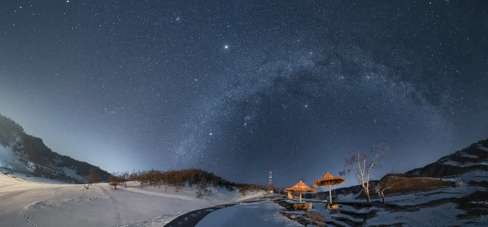

# 薛定谔的站点 / Schrödinger's Site

> 一个星空摄影师与物理学生的双重作品集：摄影一条线，工程一条线，各自独立，又共用同一套字体、栅格与动效节奏。

[在线站点](https://xue-ding-e-a.github.io/schedingers-site/) · [制作手记](https://xue-ding-e-a.github.io/schedingers-site/build/) · [联系作者](#联系)



`Astro 5` · `TypeScript` · `原生 CSS` · `中 / EN` · `GitHub Pages`

## 为什么做这个站

市面上的作品集模板足够好看，但大多只展示结果，不展示过程。这个项目想同时回答两个问题：

- 一个摄影作品集，如何让照片本身成为版式，而不是被塞进统一的卡片？
- 一个工程项目集，如何在另外三个项目没有公开仓库的情况下，仍然让人看到技术判断？

所以站点被拆成双入口：摄影线用黑色，工程线用白色，只在字体、栅格、页脚与中立索引页上保持统一。

## 功能

- 双主线门户：摄影与工程各自拥有独立导航、首页节奏与主题色。
- 10 幅星空作品、4 个系列、4 个工程项目，全部中英双语镜像。
- 精选作品按原始文件体积排序，文件越大卡片越大；仅保留横向滑动。
- 作品详情页展示拍摄地坐标、机身、镜头、EXIF 与堆栈方式。
- 导航栏在纯色背景上仍有毛玻璃、颗粒与浮起阴影。
- 默认零框架 JS；Three.js 粒子背景只在首页按需加载。
- 图片离线预处理为 WebP 与缩略图，并提取平均色作为加载占位，避免闪白。

## 技术栈

| 层 | 选择 | 理由 |
| --- | --- | --- |
| 框架 | Astro 5 | 内容多、交互少，默认零 JS |
| 类型 | TypeScript | 锁死双语的 EXIF、坐标与文案字段 |
| 样式 | 原生 CSS | 画幅从 0.67 到 2.14，手写栅格比调断点更直接 |
| 图像 | Python / Pillow | 最大原图 144MB、1.68 亿像素，构建前离线处理 |
| 背景 | Canvas 2D + Three.js | 门户星野用 2D，首页粒子背景按需加载 |
| 部署 | GitHub Pages + Actions | 推送 main 即构建发布 |

## 快速开始

需要 Node.js 20 及以上。

```bash
npm install
npm run dev       # 本地开发
npm run build     # 生成静态站点到 dist/
npm run preview   # 预览构建结果
```

## 项目结构

```text
src/
├─ components/        WorkCard、ProjectCard
├─ data/              works.ts / series.ts / projects.ts（内容与双语字段）
├─ i18n/              ui.ts（文案字典）、utils.ts（语言与路径工具）
├─ layouts/           BaseLayout.astro（导航、页脚、主题切换）
├─ pages/             中文页面；en/ 下为英文镜像
├─ styles/            global.css（设计变量与全局样式）
└─ consts.ts          站点信息与三条导航（NAV / PHOTO_NAV / DEV_NAV）
public/
└─ images/            作品图、缩略图与地图资源
```

## 内容维护

- 新增作品：编辑 [src/data/works.ts](src/data/works.ts)，补齐中英文字段与 `thumb` 路径，图片放进 `public/images/works/`。
- 新增系列：编辑 [src/data/series.ts](src/data/series.ts)，详情路由由 `src/pages/collections/[slug].astro` 自动生成。
- 新增项目：编辑 [src/data/projects.ts](src/data/projects.ts)。
- 调整导航：编辑 [src/consts.ts](src/consts.ts)，摄影与工程分别使用 `PHOTO_NAV`、`DEV_NAV`。
- 修改文案：编辑 [src/i18n/ui.ts](src/i18n/ui.ts)，同一 key 必须同时提供 `zh` 与 `en`。

## 部署

推送到 `main` 后，GitHub Actions 会自动构建并发布到 GitHub Pages，工作流见 [deploy.yml](.github/workflows/deploy.yml)。

站点地址与子路径在 [astro.config.mjs](astro.config.mjs) 中配置：

```js
site: 'https://xue-ding-e-a.github.io',
base: '/schedingers-site',
```

如果仓库改名，需要同步修改 `base`，否则静态资源会 404。

## 迭代记录

每次迭代按功能批次记录在站点的[制作手记](https://xue-ding-e-a.github.io/schedingers-site/build/)中，包括技术选型、AI 与人工的分工、时间线与踩坑复盘。近期批次：

- `2026.11.17` 先让部署跑通：子路径、Actions 与资源路径对齐
- `2026.11.17` 换掉通用深色模板：Darkness 视觉体系与首页粒子背景
- `2026.11.17` 中文字体不再「混血」：四套字体栈与全量字体
- `2026.11.17` 拆成两条主线：摄影黑 / 工程白
- `2026.11.18` 精选作品只保留横滑
- `2026.11.18` 摄影导航补上「联系」入口

## 贡献

欢迎提 Issue 指出错别字、事实错误或无障碍问题。提交 PR 前请：

1. 保持中英文字段成对；
2. 运行 `npm run build`，确认构建无报错；
3. 不要提交未压缩的原图，图片先转成 WebP 与缩略图。

## 许可与致谢

- 本站所有星空摄影作品的版权归作者所有，未经许可不得用于商业用途、展览、印刷或二次分发，详见[版权页](https://xue-ding-e-a.github.io/schedingers-site/credits/)。
- 代码暂未附带开源许可证，如需复用请先联系作者。
- 地图数据来自 OpenStreetMap 与 CARTO；字体使用 UP Job Heading、UP Job Numeric、Space Grotesk、DM Sans 与系统字体。

## 联系

- 邮箱：2543165843@qq.com
- 微信：schedinger
- GitHub：[@xue-ding-e-a](https://github.com/xue-ding-e-a)
