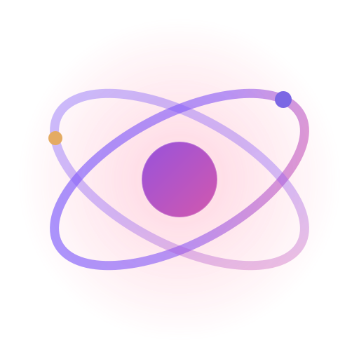
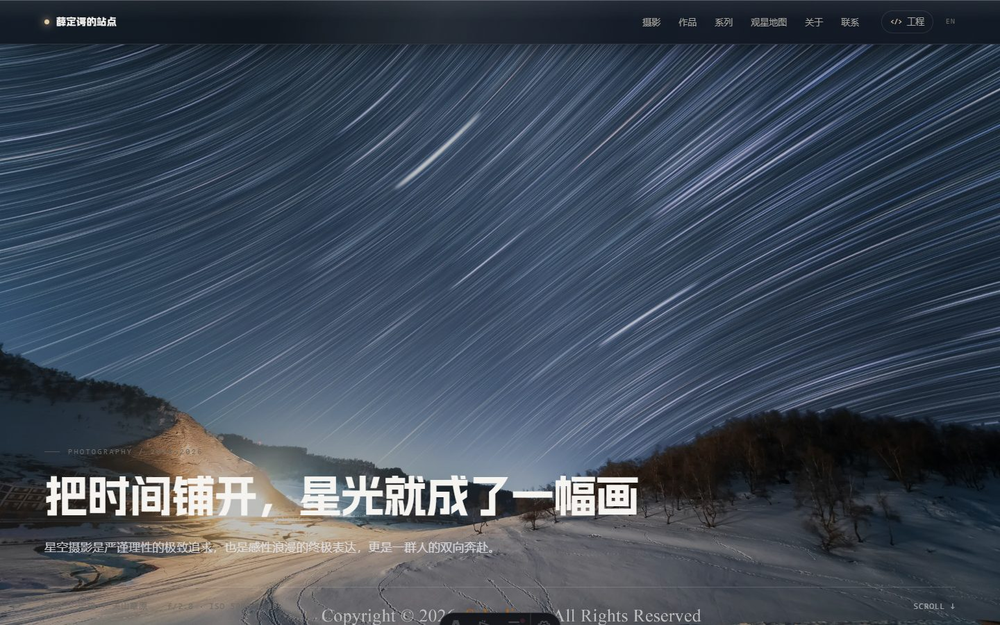
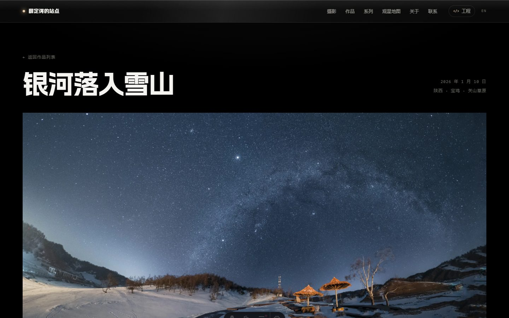
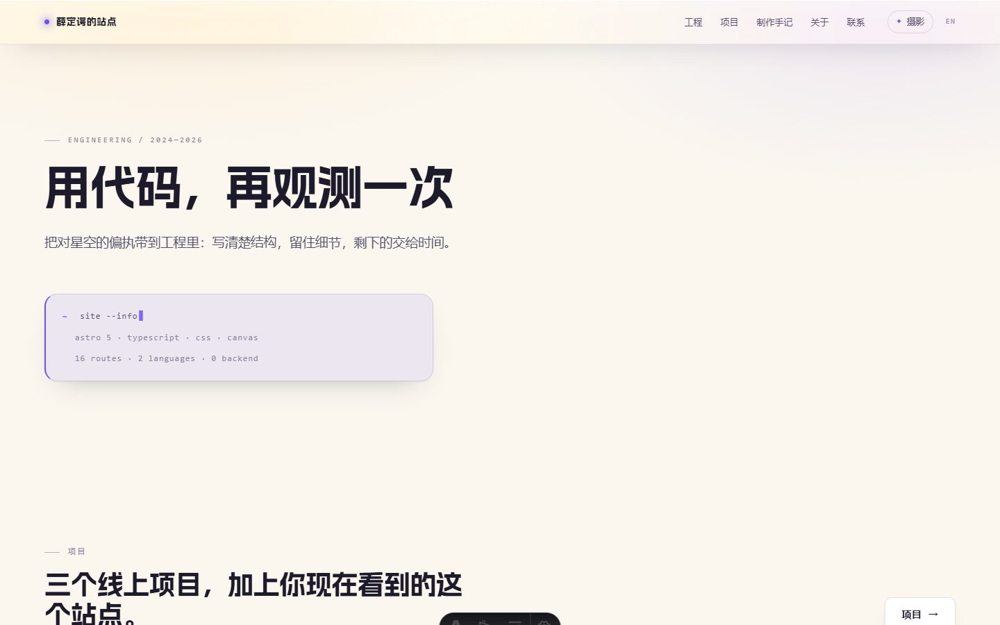

<p align="center">
  
</p>

<h1 align="center">薛定谔的站点<br><sub>SCHEDINGER'S SITE</sub></h1>

<p align="center">
  一个星空摄影师与物理学生的双重作品集：摄影一条线，工程一条线，各自独立，又共用同一套字体、栅格与动效节奏。
</p>

<p align="center">
  <a href="https://astro.build"></a>
  <a href="https://www.typescriptlang.org"></a>
  <a href="https://github.com/xue-ding-e-a/schedingers-site/actions/workflows/deploy.yml"></a>
  <a href="README.en.md"></a>
  <a href="#许可与致谢"></a>
</p>

<p align="center">
  <a href="https://xue-ding-e-a.github.io/schedingers-site/">在线站点</a> ·
  <a href="https://xue-ding-e-a.github.io/schedingers-site/photo/">摄影</a> ·
  <a href="https://xue-ding-e-a.github.io/schedingers-site/dev/">工程</a> ·
  <a href="https://xue-ding-e-a.github.io/schedingers-site/build/">制作手记</a> ·
  <a href="README.en.md">English</a>
</p>

<p align="center">
  
</p>

## 为什么做这个站

市面上的作品集模板足够好看，但大多只展示结果，不展示过程。这个项目想同时回答两个问题：

- 一个摄影作品集，如何让照片本身成为版式，而不是被塞进统一的卡片？
- 一个工程项目集，如何在另外三个项目没有公开仓库的情况下，仍然让人看到技术判断？

所以站点被拆成双入口：摄影线用黑色，工程线用白色，只在字体、栅格、页脚与中立索引页上保持统一。

## 界面



| 作品详情 | 工程首页 |
| --- | --- |
|  |  |
| 拍摄坐标、器材、EXIF 与双语故事 | 项目矩阵与终端信息卡 |

## 功能

- 摄影黑、工程白，两条主线有独立的导航与关于页。跨主线时由原子 Logo 衔接过渡。参见[摄影线](https://xue-ding-e-a.github.io/schedingers-site/photo/)、[工程线](https://xue-ding-e-a.github.io/schedingers-site/dev/)和[工程关于页](https://xue-ding-e-a.github.io/schedingers-site/dev/about/)。
- 门户先显示轻量星空，Three.js 画布首帧就绪后再切换。摄影首页用 WebP 封面与可缓存的循环星轨视频，精选作品和系列预览等到视频开始播放后再加载。关闭动效、暂停播放或播放失败时，预览仍可加载。参见[门户](src/pages/index.astro)和[摄影首页](src/pages/photo.astro)。
- 10 幅作品的「全部」视图用并排与错落组合保留完整画幅。筛选系列后，按拍摄日期分组，同日作品按卡片宽度紧凑排布。参见[作品总览](https://xue-ding-e-a.github.io/schedingers-site/works/)和[作品布局源码](src/components/WorksGallery.astro)。
- 摄影首页的精选作品横向滚动。观星地图归入系列总览，4 个系列各有独立页面。作品详情按照片原始比例收紧画框，展示拍摄坐标、器材、EXIF 与堆栈方式，并支持返回上一页。参见[系列总览](https://xue-ding-e-a.github.io/schedingers-site/collections/)和[作品详情示例](https://xue-ding-e-a.github.io/schedingers-site/works/galactic-arch-snow-mountain/)。
- 4 个工程项目均有封面和独立详情，摄影与工程内容均提供中英双语。两条主线共用页脚联系区，邮箱和微信可一键复制。参见[工程项目](https://xue-ding-e-a.github.io/schedingers-site/projects/)和[联系区源码](src/components/ContactFooter.astro)。
- 站点静态输出，交互由页面脚本处理。作品图离线生成 WebP 缩略图与响应式档位，加载时用照片平均色占位。参见[图片处理脚本](scripts/build-responsive-images.py)。

## 技术栈

| 层 | 选择 | 理由 |
| --- | --- | --- |
| 框架 | Astro 5 | 静态生成页面，原生脚本处理交互 |
| 类型 | TypeScript | 锁死双语的 EXIF、坐标与文案字段 |
| 样式 | 原生 CSS | 画幅从 0.67 到 2.14，手写栅格比调断点更直接 |
| 图像 | Python / Pillow | 最大原图 144MB、1.68 亿像素，构建前离线处理 |
| 首屏动效 | CSS + Three.js / MP4 | 门户先显示 CSS 星野，摄影首页用静态封面到循环视频的过渡 |
| 部署 | GitHub Pages + Actions | 推送 main 即构建发布 |

## 快速开始

需要 Node.js 20 及以上。

```bash
npm install
npm run dev       # 本地开发
npm run build     # 生成静态站点到 dist/
npm run preview   # 预览构建结果
```

## 项目结构

```text
src/
├─ components/        WorksGallery、WorkCard、ProjectCard、ContactFooter
├─ data/              works.ts / series.ts / projects.ts（内容与双语字段）
├─ i18n/              ui.ts（文案字典）、utils.ts（语言与路径工具）
├─ layouts/           BaseLayout.astro（导航、页脚、主题切换）
├─ pages/             中文页面；en/ 下为英文镜像
├─ styles/            global.css（设计变量与全局样式）
└─ consts.ts          站点信息与三条导航（NAV / PHOTO_NAV / DEV_NAV）
public/
└─ images/            作品图、缩略图与地图资源
```

## 内容维护

- 新增作品：编辑 [src/data/works.ts](src/data/works.ts)，补齐中英文字段与 `thumb` 路径，图片放进 `public/images/works/`。新增作品要出现在「全部」视图时，也要更新 [WorksGallery.astro](src/components/WorksGallery.astro) 的手工排版。
- 新增系列：编辑 [src/data/series.ts](src/data/series.ts)，详情路由由 `src/pages/collections/[slug].astro` 自动生成。
- 新增项目：编辑 [src/data/projects.ts](src/data/projects.ts)。
- 调整导航：编辑 [src/consts.ts](src/consts.ts)，摄影与工程分别使用 `PHOTO_NAV`、`DEV_NAV`。
- 修改文案：编辑 [src/i18n/ui.ts](src/i18n/ui.ts)，同一 key 必须同时提供 `zh` 与 `en`；README 改动同步更新 `README.en.md`。

## 部署

推送到 `main` 后，GitHub Actions 会自动构建并发布到 GitHub Pages，工作流见 [deploy.yml](.github/workflows/deploy.yml)。

站点地址与子路径在 [astro.config.mjs](astro.config.mjs) 中配置：

```js
site: 'https://xue-ding-e-a.github.io',
base: '/schedingers-site',
```

如果仓库改名，需要同步修改 `base`，否则静态资源会 404。

## 迭代记录

每次迭代按功能批次记录在站点的[制作手记](https://xue-ding-e-a.github.io/schedingers-site/build/)中，包括技术选型、AI 与人工的分工、时间线与踩坑复盘。近期批次：

- `2026.11.22` 定稿作品总览的策展排版，按拍摄日期紧凑排列筛选结果，统一摄影卡片交互与两条主线的联系页脚。
- `2026.11.21` 门户先显示轻量星空，摄影首页改用可缓存的星轨循环视频，并延后加载照片预览。
- `2026.11.20` 拆分摄影和工程的关于页，平滑跨主线的 Logo 过渡，适配浏览器深浅配色图标，补齐系列显影及作品详情的原比例画框和返回操作。
- `2026.11.19` 为工程项目补齐封面和 WowLand 招募宣讲案例，调整导航胶囊以减少浏览器间的色差。
- `2026.11.18` 精选作品改为横向滚动，观星地图并入系列总览，加入字体子集与作品图的响应式档位。
- `2026.11.17` 跑通 GitHub Pages 部署，建立字体与视觉体系，拆分摄影黑、工程白两条主线。

## 贡献

欢迎提 Issue 指出错别字、事实错误或无障碍问题。提交 PR 前请：

1. 保持中英文字段成对；
2. 运行 `npm run build`，确认构建无报错；
3. 不要提交未压缩的原图，图片先转成 WebP 与缩略图。

## 许可与致谢

- 本站所有星空摄影作品的版权归作者所有，未经许可不得用于商业用途、展览、印刷或二次分发，详见[版权页](https://xue-ding-e-a.github.io/schedingers-site/credits/)。
- 代码暂未附带开源许可证，如需复用请先联系作者。
- 地图数据来自 OpenStreetMap 与 CARTO；字体使用 UP Job Heading、UP Job Numeric、Space Grotesk、DM Sans 与系统字体。

## 联系

- 邮箱：2543165843@qq.com
- 微信：schedinger
- GitHub：[@xue-ding-e-a](https://github.com/xue-ding-e-a)
